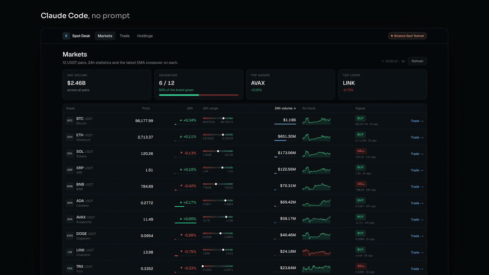

# Tradeboard starter

The data layer for [Tradeboard](https://ssych.com/case-studies/tradeboard), with no screens yet. Paste `PROMPT.md` into Claude Code and it builds the three screens, Markets, Trade and Holdings, with the free [ssych](https://ssych.com) components.

- `src/lib/binance.ts`: live Binance prices, candles and order books (public, no key)
- `src/lib/signals.ts`: buy and sell signals from a 9/21 EMA crossover
- `src/app/api`: a Binance Spot Testnet account: balances, trades, value history, market orders

## Run it

1. `npm install`
2. Get free testnet keys at [testnet.binance.vision](https://testnet.binance.vision) and put them in `.env.local` (see `.env.example`). Without keys the market screens still work.
3. Open Claude Code in this folder and paste the contents of `PROMPT.md`.
4. `npm run dev`

The testnet uses fake money. Nothing here touches a real Binance account.
